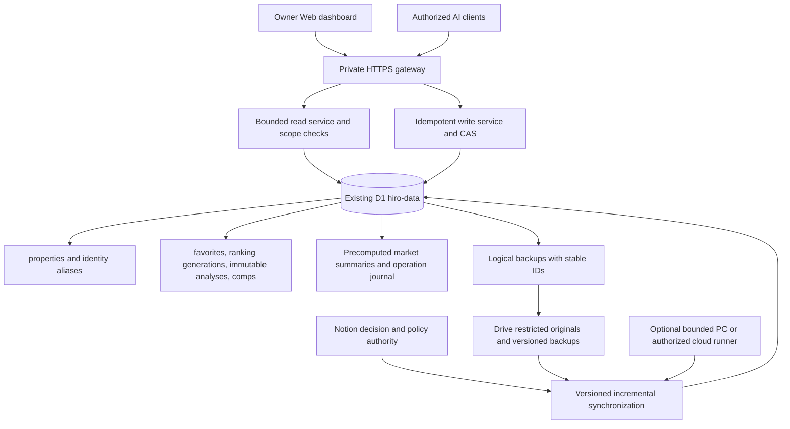

# Shared property data architecture - decision record (2026-11-28)

Status: design conditional PASS from Claude Fable 5.2; rollout incomplete. No new paid service or full local mirror. This document defines acceptance gates, not a claim that every component exists.

## Architecture

The online authoritative data store is existing D1; Notion remains authority for user decisions and policy. Drive retains permitted originals, historical snapshots, provenance and logical backups. Local storage is only bounded temporary processing; no running SQLite file on a synced folder. No required Windows hop for read operations. Do not export restricted materials to an AI or cloud destination without verifying contractual permission.

## Fable review and adopted decisions
- Keep one D1 now, with canonical IDs, source advertising IDs, immutable analysis and rank generations. A canonical advertising identity is not proof of physical identity.
- P0 read quota: exact indexed IDs and structured filters; keyset pagination; precompute summaries and counts; no repeated full scans. Remove expensive COUNT/LIKE paths after equivalent replacement; track actual rows_read/rows_written and end-to-end p95. Daily limits are shared across databases and clients; reserve owner access and apply aggregate admission before quota exhaustion.
- P0 write amplification: only changed hash rows; no blanket daily last-seen writes; measure actual index and journal writes, not just row count. Use bounded batches with retry/idempotency. Do not set a rigid index count without measured plans.
- P0 backup: preserve source and canonical identity maps/aliases, favorites, analyses, decisions mirror and journals, with manifests/hashes and generation IDs. Test restore into isolated DB; never restore production for a test. Drive archival and optional cloud runner must obey source rights.
- P0 access: per-agent credentials with identity derived from authentication; scope allowlist and revocation; no arbitrary SQL or owner-token sharing. Treat data as untrusted. Until REINS and other restricted-source terms/permissions are verified, deny restricted/unknown source data and derived records to non-owner agents. This applies to search/detail/comps/summary/cache. No production migration of existing client scopes without compatibility tests.
- P0 concurrent write: atomic CAS/journal insertion/rollback, duplicate operation ID replay same payload only; conflicting payload fails. Reuse existing trigger-based observation flow and test real concurrency; do not assume a zero-row update implies rollback.
- P1 freshness: generation ID, computed_at, source hash, source date, stale reason; immutable prior snapshots and pointer switch. No automatic deletion of historical data before backup/retention approval.
- P1 cache: scope + license + generation key; never mix private and public caches. Return evidence links only to authorized clients.
- P1 portability: same services for MCP and bounded REST/OpenAPI; OAuth where client requires it. Check real Claude, Codex, ChatGPT, Antigravity, Muse, Grok, and other authorized clients individually. No claim of universal client compatibility.
- P1 capacity: preliminary warnings at 350 MB and 425 MB, adjust after measurement and account-plan check. Consider separating bulky source payloads from decision core only when necessary; cross-D1 joins/transactions cannot be assumed. Keep R2 and separate paid services deferred.
- Use existing ingest/supervisor for differential sync and recovery; no competing scheduler, duplicate database, or duplicate outreach.

## Current verified checkpoint
- Existing D1 219000832 bytes, 109 active ranking rows, 3 selected favorites, one analysis snapshot.
- Exact analysis read 3 rows, 0.6744 ms SQL execution only; network and AI response time not included.
- Existing code commit 4f991f44a40925c6377353a6e42fa3e5483f2631 adds analysis read, detail UI, stale hash check, migration, tests; no production deployment.
- Fable 5.2 CLI completed (conditional architecture PASS, implementation not reviewed); official Cloudflare docs confirmed free 500MB/database, 5GB/account, 5M reads/day, 100k writes/day, 7-day Time Travel, index writes, and atomic batch on statement failure. Actual account plan/usage unverified.
- Reference: https://developers.cloudflare.com/d1/platform/pricing/
- Reference: https://developers.cloudflare.com/d1/platform/limits/
- Reference: https://developers.cloudflare.com/d1/worker-api/d1-database/
- Reference: https://developers.cloudflare.com/d1/reference/time-travel/

## Acceptance matrix (required before completion)
1. Real query plans and rows_read; exact lookup and 25-row pages <=500 target, no unbounded normal query. Measure per route, including UI.
2. Budget tests: per-agent and account quota; owner reserve; degradation and safe retry; no query bypass.
3. Identical reingest writes approximately zero; changed rows only; measure index costs.
4. Real concurrent same-hash update: exactly one success, other conflict, no phantom journal/child records.
5. Same operation replay stable result; changed payload conflict.
6. Generation build and pointer switch: no mixed generations.
7. Identity merge/split without losing favorite/analysis associations; source evidence preserved, unresolved matches remain separate.
8. Drive backup and isolated restore without Windows, IDs/hashes/counts match, no orphans; actual restore time.
9. Scope tests for read/write, identity, expiry/revocation, no secrets in logs; owner and client-specific auth.
10. REINS/unknown restriction tests across all read and cache paths, including aggregates; verify actual terms first.
11. Measure p95/p99 latency, rows, CPU and concurrency on actual clients; no promised end-to-end latency before measurement.
12. Stored prompt injection and HTML escaping; permissions not affected by content.
13. All historical chat instructions: current sale status, competing offers, direct listing agent and negotiability; station walk, nearest terminal and Tokyo travel; rent demand/supply, asking and closed yields separately, land comparables/unit values, discount by all costs, three exit scenarios, renovation and acquisition costs; missing data remains unknown; no false completed/rebuildable flag. Keep exclusions and source/observed date.
14. Backfill approved candidates and favorites, reconcile exact IDs and existing Notion/Drive evidence, verify web + MCP + SQL and each supported agent from its actual runtime. Preserve existing holds, no unauthorized contact or offer.
15. Independent maker/checker review of actual code and schema, CI, authenticated E2E, recovery and ongoing runs. All PASS before declaring complete.

## Rollout gates
Draft branch only until licensing, scopes, regression tests, review and CI are verified. Apply additive migrations only; rollback plan and no destructive changes. Existing production remains untouched.
